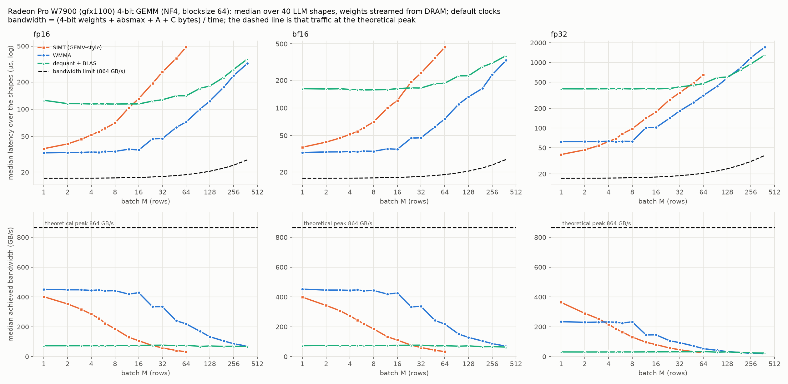
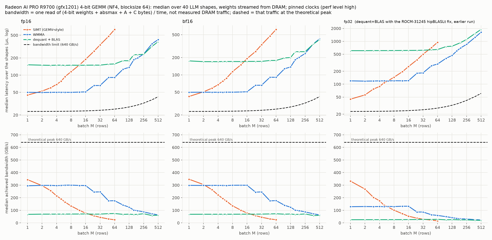

# 4-bit GEMM WMMA plots

All runs: NF4, blocksize 64, 40 LLM linear-layer shapes (`shapes.py`), weights streamed from DRAM (no L2 reuse
between iterations), pinned GPU clocks (`amd-smi set -l HIGH` / `power_dpm_force_performance_level=high`). Raw data is
under `../data/<arch>/pinned/`; each plot's inputs are listed with SHA-256 in its `*.manifest.json`.

## New dispatch vs upstream main

SIMT for M <= 8 and dequant + `F.linear` above (main) vs this branch's default dispatch, with the Python M limits
applied. Table: [speedup_vs_main.md](speedup_vs_main.md). Script: `../plots_vs_main.py`.

## Kernels vs the bandwidth limit, per GPU

SIMT (GEMV-style), WMMA and dequant + BLAS, each forced, against the time to move the GEMM's bytes once at peak DRAM
bandwidth. The median plot shows latency and achieved bandwidth (median over the 40 shapes); the per-shape plots show
the latency of every shape. Script: `../plots_kernels.py`.

| GPU | median over shapes | every shape: fp16 | bf16 | fp32 |
|---|---|---|---|---|
| Radeon Pro W7900 (gfx1100, 864 GB/s) | [median](gfx1100/kernels_median.png) | [fp16](gfx1100/kernels_per_shape_fp16.png) | [bf16](gfx1100/kernels_per_shape_bf16.png) | [fp32](gfx1100/kernels_per_shape_fp32.png) |
| Radeon AI PRO R9700 (gfx1201, 640 GB/s) ¹ | [median](gfx1201/kernels_median.png) | [fp16](gfx1201/kernels_per_shape_fp16.png) | [bf16](gfx1201/kernels_per_shape_bf16.png) | [fp32](gfx1201/kernels_per_shape_fp32.png) |
| Radeon 8060S (gfx1151, 256 GB/s) | [median](gfx1151/kernels_median.png) | [fp16](gfx1151/kernels_per_shape_fp16.png) | [bf16](gfx1151/kernels_per_shape_bf16.png) | [fp32](gfx1151/kernels_per_shape_fp32.png) |
| Radeon 760M (gfx1103, 89.6 GB/s) | [median](gfx1103/kernels_median.png) | [fp16](gfx1103/kernels_per_shape_fp16.png) | [bf16](gfx1103/kernels_per_shape_bf16.png) | [fp32](gfx1103/kernels_per_shape_fp32.png) |

¹ fp32 dequant + BLAS on gfx1201 uses hipBLASLt with the ROCm/rocm-libraries#12465 fix (see `../README.md`, Known
issues); with the affected ROCm 10.2 nightlies it is several times slower.

### Radeon Pro W7900 (gfx1100)

### Radeon AI PRO R9700 (gfx1201)

### Radeon 8060S (gfx1151)

### Radeon 760M (gfx1103)

## Development history

Final branch vs the first WMMA version (default dispatch, A/B/A runs; the dotted line is the baseline's run-to-run
noise): [W7900](gfx1100/speedup_final_vs_first_wmma.png), [RX 7900 XTX](gfx1100_7900xtx/speedup_final_vs_first_wmma.png)
(default clocks), [760M](gfx1103/speedup_final_vs_first_wmma.png),
[R9700](gfx1201/speedup_final_vs_gfx1201_branch.png) (vs the first gfx1201 version). Script: `../plots_compare.py`.

Older files in the per-GPU folders (`speedup_vs_previous_dispatch*.png`, `median_latency*.png`, `per_shape_*.png`)
come from intermediate code at default clocks and are superseded by the plots above.
