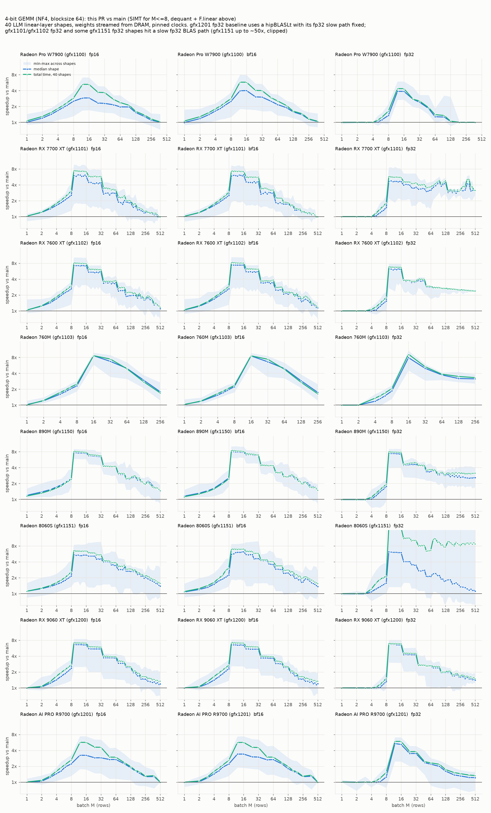
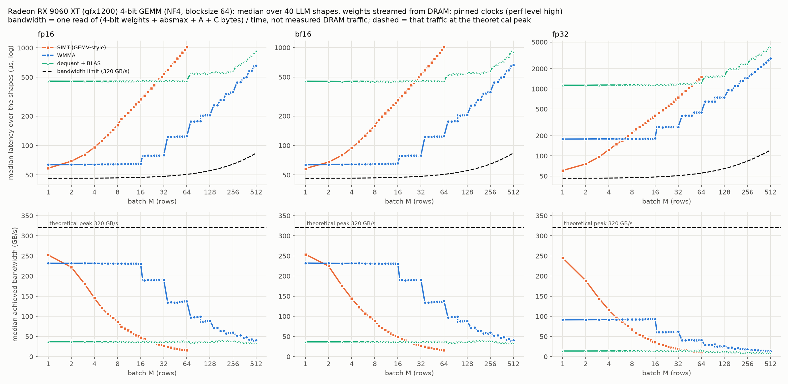
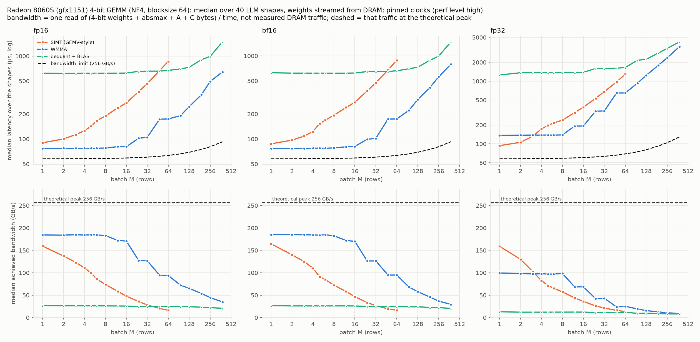
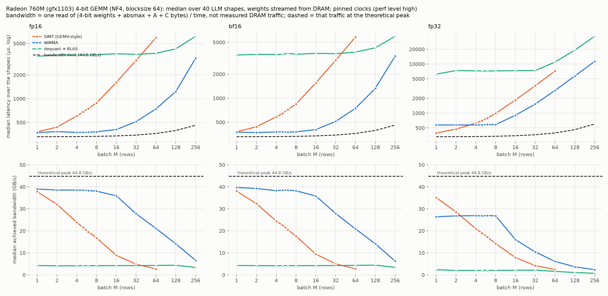

# Plots

NF4, blocksize 64, 40 LLM linear-layer shapes (`../shapes.py`), weights streamed from DRAM, pinned GPU clocks. Each
kernel plot's input CSVs are listed with their SHA-256 in `kernels.manifest.json` next to it.

## Default dispatch vs upstream main

main: SIMT for M <= 8, dequant + `F.linear` above. New: this branch's default dispatch, including the Python M limits.
Table: [speedup_vs_main.md](speedup_vs_main.md). Script: `../plots_vs_main.py`.

## Kernels vs the bandwidth limit

SIMT (GEMV-style), WMMA and dequant + BLAS, each forced, against the time to read the GEMM's bytes (4-bit weights,
absmax, A, C) once at peak DRAM bandwidth. Script: `../plots_kernels.py`.

| GPU | peak | median over the shapes | every shape: fp16 | bf16 | fp32 |
|---|---|---|---|---|---|
| Radeon Pro W7900 (gfx1100) | 864 GB/s | [median](gfx1100/kernels_median.png) | [fp16](gfx1100/kernels_per_shape_fp16.png) | [bf16](gfx1100/kernels_per_shape_bf16.png) | [fp32](gfx1100/kernels_per_shape_fp32.png) |
| Radeon AI PRO R9700 (gfx1201) | 640 GB/s | [median](gfx1201/kernels_median.png) | [fp16](gfx1201/kernels_per_shape_fp16.png) | [bf16](gfx1201/kernels_per_shape_bf16.png) | [fp32](gfx1201/kernels_per_shape_fp32.png) |
| Radeon RX 9060 XT (gfx1200) | 320 GB/s | [median](gfx1200/kernels_median.png) | [fp16](gfx1200/kernels_per_shape_fp16.png) | [bf16](gfx1200/kernels_per_shape_bf16.png) | [fp32](gfx1200/kernels_per_shape_fp32.png) |
| Radeon 8060S (gfx1151) | 256 GB/s | [median](gfx1151/kernels_median.png) | [fp16](gfx1151/kernels_per_shape_fp16.png) | [bf16](gfx1151/kernels_per_shape_bf16.png) | [fp32](gfx1151/kernels_per_shape_fp32.png) |
| Radeon 760M (gfx1103) | 89.6 GB/s | [median](gfx1103/kernels_median.png) | [fp16](gfx1103/kernels_per_shape_fp16.png) | [bf16](gfx1103/kernels_per_shape_bf16.png) | [fp32](gfx1103/kernels_per_shape_fp32.png) |

The gfx1201 fp32 dequant + BLAS line uses hipBLASLt with ROCm/rocm-libraries#12465 (see `../README.md`).

### Radeon Pro W7900 (gfx1100)

### Radeon AI PRO R9700 (gfx1201)

### Radeon RX 9060 XT (gfx1200)

### Radeon 8060S (gfx1151)

### Radeon 760M (gfx1103)

